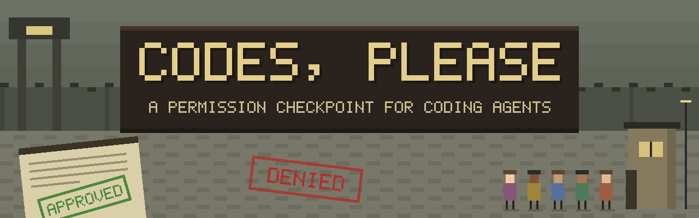

# Codes, Please

*[Türkçe](README.tr.md)*

**Your coding agent wants to cross the border. You are the inspector.**

Codes, Please is a *Papers, Please*-style checkpoint for Claude Code. Every time the agent asks for permission (to run a command, edit a file, fetch a page), the request doesn't show up as a terminal prompt. Instead, an applicant walks up to your booth window and slides their paperwork across a wooden desk:
- a request form,
- a diff of the file they want to change,
- their own statement of what they're doing,
- a report of what they've been reading.

You inspect the documents, drag the form under the stamp you want, and bring it down: **APPROVED**, **REJECTED**, or returned with a note. Your decision goes straight back to the agent.

It also keeps a filing cabinet of your Claude Code sessions:
- It finds every session from the last week on disk, even ones started before you installed it.
- Each folder follows the agent live: which tool it's running and what it said.
- It flags the sessions where the agent has finished and it's **your turn**.
- You can post a letter to an agent while it works.

Grim 1980s bureaucracy, muted pixel art, rubber stamps and all.

> Inspired by Lucas Pope's *Papers, Please*. This is an unofficial fan project, not affiliated with or endorsed by its creators. All art, names and text here are original.

## Install

Requires Node.js 20.11 or newer.

```bash
npx codes-please install   # backs up ~/.claude/settings.json, adds only this tool's hook entries
npx codes-please           # opens the booth at http://127.0.0.1:4777
```

Or install it globally:

```bash
npm install -g codes-please
codes-please install
codes-please
```

| Command | What it does |
| --- | --- |
| `codes-please` / `codes-please start` | Open the booth (add `--no-open` to skip opening the browser) |
| `codes-please demo` | Open the booth with fake applicants, no Claude Code needed |
| `codes-please install` | Add the hooks (a backup of your settings is made first) |
| `codes-please uninstall` | Remove only this tool's hooks; your other hooks stay in place |

- On first run a random access token is written to `~/.checkpoint-booth/config.json` (mode 0600). The UI link carries the token, and the token is then removed from the address bar.
- The hook script is copied to `~/.checkpoint-booth/`, so the hooks keep working even if the npx cache is cleared.
- Already-open Claude Code sessions pick up hook changes after you open and close the `/hooks` menu, or after a restart.

## At the booth

1. Press **NEXT!** (or Enter) to call the next applicant to the window. Their documents slide onto the desk.
2. Read the papers. Drag them around and stack them; double-click one to zoom in. Long diffs are paged, and you'll hear the page turn.
3. The stamp rail slides out from the right. Drag the **request form** under the stamp you want and click the stamp. Wherever the paper is under the rubber, it gets inked. Miss the paper and you just thump the desk.
4. Optionally write on the **note slip**, then press **HAND BACK** (or Enter).

| Key | Action |
| --- | --- |
| Enter | Call the next applicant / hand the papers back |
| A / R / P | Bring down APPROVE, REJECT or PERMANENT, aimed at the form's stamp box (K also works for PERMANENT) |
| N | Focus the note slip; a note handed back without a stamp counts as NOTE |
| Esc | Leave the note slip or close an open folder |

What each decision does:
- **APPROVE + note:** The action is allowed. The note reaches Claude via PostToolUse after the tool runs.
- **REJECT + note:** The note is sent as the reason for rejection.
- **NOTE:** The request is denied. The note is sent as an instruction: "don't do this, do that instead".
- **PERMANENT:** The rule Claude suggested is applied for this session only (`updatedPermissions`, `destination: "session"`).
- **Mail:** A letter written from a session's folder is delivered at the first suitable hook: PreToolUse, PostToolUse, UserPromptSubmit, or a Stop that it blocks.

Messages sent to Claude are always in English, whatever the UI language.

## Safety net

The hook prints nothing and exits 0 in each of these cases, so Claude Code falls back to its normal terminal prompt:
- The server is down.
- The token is wrong.
- No UI is open.
- The UI has been closed for more than 15 seconds.
- Any error occurs.

If you answer a request in the terminal instead, the applicant leaves the queue and the history records it as "TERMINAL".

## Roadmap

- [x] Approval booth: queue, documents, drag-under-the-stamp stamping, note slip
- [x] Session cabinet: discovery of on-disk sessions, live log, "your turn" status, mailbox
- [x] English and Turkish UI
- [ ] Own sessions through the Claude Agent SDK: start new sessions, message idle ones, stop them
- [ ] Interrupt and permission-mode controls (e.g. switch a session to plan mode)
- [ ] Track subagents separately from their parent session
- [ ] Cost and context usage per session
- [ ] Search, group by project, rename and archive folders
- [ ] Codex adapter
- [ ] Smarter live log that skips large tool results

## Development

```bash
git clone https://github.com/omerfaral/codes-please && cd codes-please
npm install
npm test               # real hook script ↔ real server ↔ fake UI
npm run demo           # build, then open the booth with fake applicants
npm run install-hooks  # point your hooks at this checkout
```

Demo applications go through the real adapter. The JSON that would be sent to the agent shows up in the "Radio Log" at the bottom left. To start another round at any time, use **SETTINGS → Send demo applications**.

## Architecture

```
hooks/booth-hook.cjs      zero-dependency bridge: stdin → POST /hook/claude/<event> → stdout
server/cli.ts             command-line entry point (bundled to bin/codes-please.mjs)
server/index.ts           HTTP + WebSocket, bound to 127.0.0.1 only
server/adapters/claude.ts Claude Code hook schema ↔ agent-agnostic core
server/core.ts            queue, decisions, note queue, mailbox, diff document, session discovery, live transcript polling
server/transcript.ts      title, statement, research report and recent messages from the JSONL transcript
web/src/                  React UI; the scene is procedural pixel art on canvas
web/src/i18n.ts           UI strings (English primary, Turkish)
docs/banner.svg           README banner
```

To add another agent (e.g. Codex), write a file that implements the `Adapter` interface and add it to `ADAPTERS` in `server/index.ts`. To add a UI language, add a dictionary to `web/src/i18n.ts`; it must match the shape of the English one.

## Differences from the hook docs

- The `PermissionRequest` input has **no** `tool_use_id`. So a note attached to an approved request is queued by session + tool name + `tool_input`, and PostToolUse finds it by that key.
- `permission_suggestions` is provided. The PERMANENT stamp echoes it back with `destination: "session"`. If there is no suggestion, it builds the rule itself (`command:*` for Bash).
- The Stop hook blocks stopping with `decision: "block"` + `reason`. It returns nothing when the mailbox is empty, so it cannot loop.
